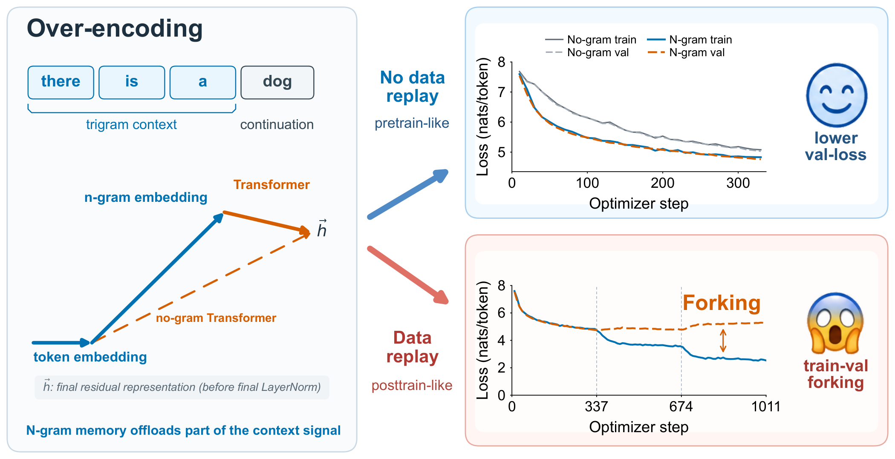
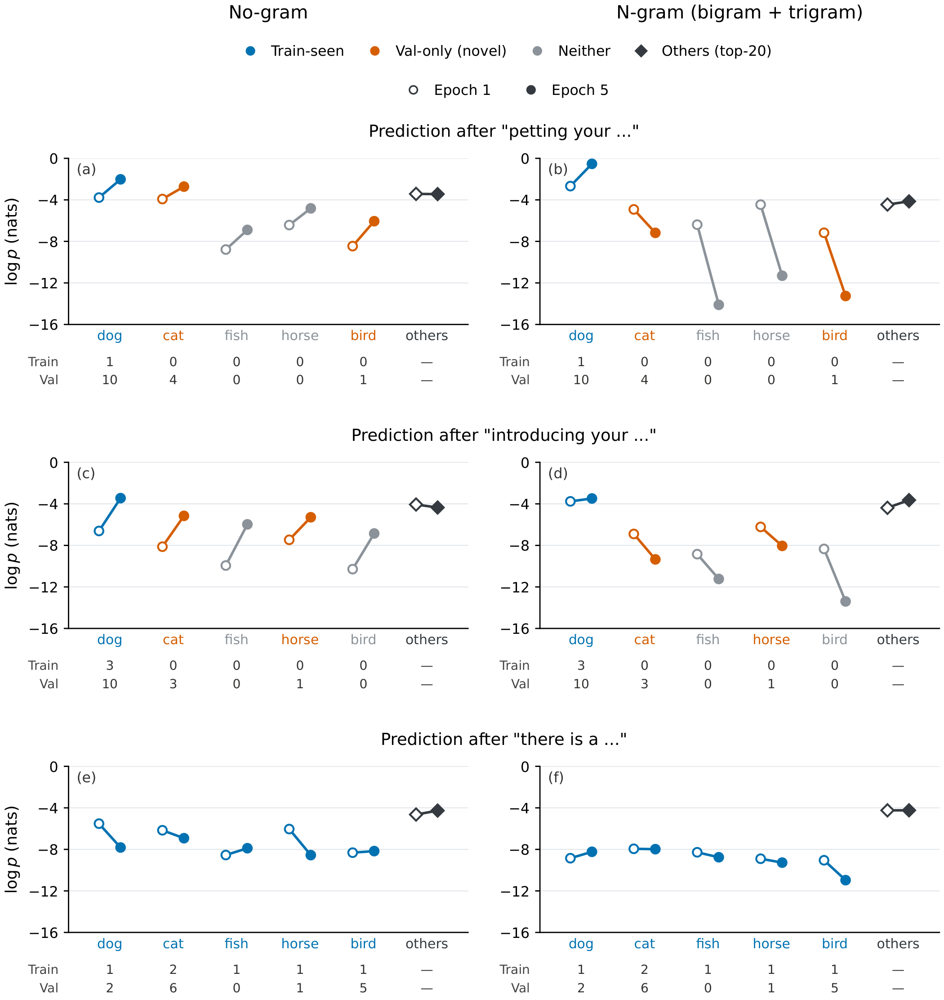

# Forking: Sudden Overfitting Under Replay

**When the same text returns, fitting and generalization can take different paths.**

Forking studies a sharp, replay-aligned increase in the training–validation loss gap in language models with local n-gram memory. Controlled experiments connect this behavior to continuation coverage, memory capacity, and repeated exposure to a finite corpus.

[Website](https://guoshaoyang-pku.github.io/forking/) · [Paper (to be added)](#paper) · [License (to be selected)](#license)

[Reproduce the analysis](reproduce/README.md) · [Training protocol](docs/TRAINING.md) · [Evidence guide](docs/REVIEW_GUIDE.md) · [Availability](docs/AVAILABILITY.md)

## Start here

Clone the release branch and run the two numerical checks with Python 3.10 or newer. The checks need no packages, GPU, or model download.

~~~sh
git clone --branch release --single-branch https://github.com/guoshaoyang-pku/forking.git
cd forking
python3 reproduce/verify_coverage.py
python3 reproduce/verify_contexts.py
~~~

The first command independently recomputes **eight coverage fits from three training seeds**, including residuals and an alternating-bin holdout check. The second checks **72 context-level endpoint observations**, their token classes, probability transforms, and checkpoint coordinates. Both print PASS and exit with code 0 on the packaged inputs; disagreements fail with a specific error.

These commands reproduce analysis of bundled observations. Training requires the additional data assets described in the [training protocol](docs/TRAINING.md).

## Three questions, one evidence trail

| Question | Evidence | What to inspect |
| --- | --- | --- |
| When does generalization separate from fitting? | Replay-aligned trajectories and repeated-pass controls | [Replay figure](docs/figs/replay.pdf) and fixed replay iteration in [train.py](code/train.py) |
| Which predictions are hurt? | Seen contexts with novel continuations; concrete context-level probes | [Measured endpoints](docs/figs/context-examples.pdf), [CSV](evidence/context-examples/context_examples_plotted_values.csv), [checkpoint metadata](evidence/context-examples/context_examples_manifest.json) |
| Can coverage organize the gap? | Three-seed frequency-bin observations and affine fits | [Coverage figure](docs/figs/coverage.pdf), [observations](evidence/coverage/online_points.csv), [independent calculation](reproduce/verify_coverage.py) |

## Inspect the next-token predictions

These context probes show how probability changes between the first and fifth pass, comparing the no-gram and local-memory models. A context can occur in training while some plausible continuations remain unseen.

**Open points: epoch 1. Filled points: epoch 5. Higher means more probable.** Colors describe corpus membership. The measurements use seed 42 at steps 337 and 1685; connecting lines show two endpoints, not a monotone intermediate trajectory.

The input is BOS plus exactly three context tokens. “Others” is the log of the mean probability of the top 20 remaining tokens, reranked separately for each distribution. See the [measurement details](docs/EVIDENCE.md), [endpoint values](evidence/context-examples/context_examples_plotted_values.csv), and [checkpoint metadata](evidence/context-examples/context_examples_manifest.json).

## Why it matters

Memory capacity can improve fitting while exposing a weakness under data reuse. Evaluating only the first pass can miss this later change. Forking makes that risk inspectable through repeated-pass controls, continuation-level measurements, and interventions on the local-memory pathway.

The fixed context-to-row mapping does not receive a train/validation membership flag. The same context uses the same addressing rule. The distinction emerges through learning and the finite set of continuations available in training. Broader claims about independent context subspaces or all sparse architectures require additional evidence.

## A small repository with explicit boundaries

~~~text
code/          Model, trainer, frequency measurement, diagnostics
configs/       Explicit local-memory and no-gram baseline settings
reproduce/     Numerical checks and independent replotting
scripts/       Data validation and portable GPU launch wrapper
evidence/      Small CSV packets and source/checkpoint identities
tests/         Measurement implementation checks
docs/          Project page, paper figures, and concise guides
tools/         Site rendering and release integrity checks
~~~

To redraw the coverage relationships from their observations:

~~~sh
python3 -m pip install -r requirements-figures.txt
python3 reproduce/plot_coverage.py --output outputs/coverage.png
~~~

To check selected measurement paths:

~~~sh
python3 -m pip install -r requirements-test.txt
python3 -m pytest -q
~~~

The numerical check, implementation tests, and GPU training have distinct scopes. [Availability](docs/AVAILABILITY.md) records what is included and what is still needed for a complete training rerun, final paper link, and licensed public release.

To preview the project page locally, run python3 -m http.server 8000 --directory docs and open http://localhost:8000. No website build is needed to view the included HTML.

## Paper

**Forking: Sudden Overfitting Under Replay** — paper link and citation to be added.

## License

License to be selected. A formal LICENSE file will be added here once the license is confirmed.
