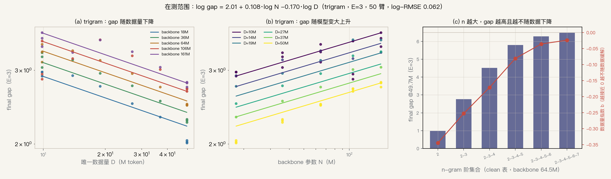
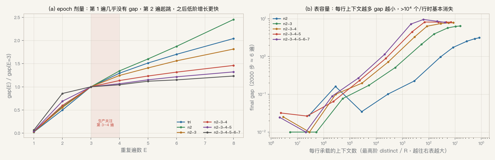
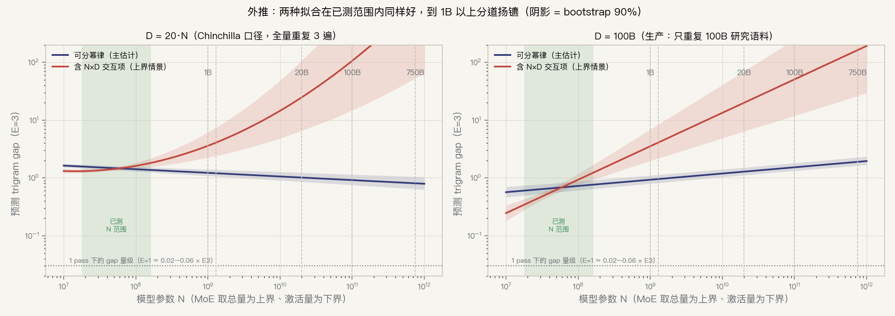

# v2 第一条线：forking 的 scaling 关系与外推（2026-10-17）

> 脚本 `docs/plot_scripts/gen_v2_scaling_extrapolation.py`；数据为本地 harvest
> `output/harvest_e3/`（§78）与 `output/harvest_v224/`（§74/§75）；拟合参数 `fit_params.json`，
> 外推表 `extrapolation.csv`；图 `docs/figs/v2_scaling_20261017/`。全部结论为外推，标「假设」。

## 0. 目标 setting

| 阶段 | 模型 | 唯一数据 D | 重复 |
|---|---|---|---|
| 第一阶段 | Dense 1B | 20B（= 20 × N） | 3–4 遍 |
| 第一阶段 | Dense 20B | 400B | 3–4 遍 |
| 第一阶段 | MoE 家族最大者 FLAME-Large 290M 激活 / 1.3B 总量 | 26B（= 20 × 总量） | 3–4 遍 |
| 生产 | Dense 100B，或 MoE 750B-A10B | 语料 15–30T，其中 100B 研究语料被重复到第 3、4 遍 | 子集 3–4 遍 |

750B-A10B 的参照是 DeepSeek-V4.1-Flash（[model card](https://huggingface.co/deepseek-ai/DeepSeek-V4.1-Flash)）：
- 参数：552B backbone + 196B Engram ≈ 748B 总量；每 token 激活 8B（prefill）/ 16B（decode）。
- MoE：1 个 shared + 384 个 routed expert，每 token 激活 top-6。
- 预训练：45T token。
- Engram：两个模块，每模块 n-gram 阶 {2,3,4}，8 个 hash head，每阶 2048 维；带 context-aware gating，用 momentum + Sinkhorn 优化。
  折算每阶每 head 约 1.6×10⁷ 行（196B / (2 模块 × 3 阶 × 2048 维)）。

## 1. 已测范围内的 scaling 关系

**拟合**：trigram-only、clean 表 R=2²⁰、E=3，5 档 backbone（17.8M–161.5M）× 6 个数据池（9.9M–49.7M），
含 seed 43/44，共 50 臂。

`log gap = 2.01 + 0.108·log N − 0.170·log D`（log-RMSE 0.062）

| 变量 | 关系 | 数字 |
|---|---|---|
| 模型 N | 越大越 fork | 指数 a = +0.108（90% 区间 0.090–0.125） |
| 数据 D | 越多越缓解 | 指数 b = −0.170（−0.193～−0.147） |
| 沿 D/N 固定 | 两者近乎抵消，略降 | a+b = −0.06（−0.080～−0.041） |
| n | 越大 gap 越高，越不随数据缓解 | 49.7M 池 gap：n2 0.98 → n2-4 4.50 → n2-7 6.48；数据指数 −0.35 → −0.17 → −0.02（backbone 64.5M） |
| 重复遍数 E | 第 1 遍几乎为 0，第 2 遍起跳，之后持续上升 | gap(E)/gap(3)：E1 0.02–0.06，E2 0.5–0.86，E4 1.04–1.34 |
| 表容量 R | 每行承载的上下文越多，gap 越小 | 每行 >10⁴ 个上下文时基本消失（2000 步） |

**旧问题「数据到 1B 时 forking 消失」的解释**：旧设计固定 2000 步，1B 池只训到 0.3 遍，没有任何重复。
E=1 时的 gap 只有 E=3 的 2–6%，所以「消失」来自没有重复，不是数据量本身。依据是本表的 epoch 比值，属假设。

## 2. 外推

两种函数形式在已测范围内都拟合得好：
- 可分幂律：log-RMSE 0.062。
- 加 log N × log D 交互项：log-RMSE 0.055，交互系数 +0.056，90% 区间 0.033–0.081，不含 0。

但两者外推方向相反，这是当前最大的不确定性。下表是 trigram gap 的预测：

| 目标 | D/N | 可分幂律 E=3 [90%] | E=4 | 交互项 E=3 |
|---|---:|---:|---:|---:|
| 实验室最大点（已测 2.78） | 0.31 | 2.80 [2.74, 2.85] | 3.62 | 2.9 |
| Dense 1B · D=20B | 20 | 1.22 [1.09, 1.40] | 1.58 | 3.6 |
| FLAME-Large · D=26B（N 取 1.3B 总量） | 20 | 1.20 [1.06, 1.39] | 1.56 | 4.1 |
| FLAME-Large · D=26B（N 取 290M 激活） | 90 | 1.02 [0.90, 1.19] | 1.33 | 1.9 |
| Dense 20B · D=400B | 20 | 1.01 [0.86, 1.23] | 1.31 | 24.8 |
| Dense 100B · 只重复 100B 子集 | 1 | 1.53 [1.33, 1.81] | 1.98 | 50.8 |
| 750B 总量 · 只重复 100B 子集 | 0.13 | 1.90 [1.63, 2.27] | 2.46 | 163 |
| 10B 激活 · 只重复 100B 子集 | 10 | 1.19 [1.03, 1.41] | 1.54 | 13.4 |

**判读（假设）**
1. 两种形式都预测 forking 在目标规模不会消失。按 Chinchilla 比例（D=20N）重复 3–4 遍时，
   可分幂律给出约 1–1.6 nats 的 trigram gap，约为当前 1000 步 trigram-only 主实验（2.49，`s1v5_128_marm_trigram`）的一半，远高于 1 遍的水平（≈0.05）。
2. 生产场景其实比 Chinchilla 口径更危险：被重复的只是 100B 子集，对 100B–750B 模型而言
   D_rep/N ≈ 0.13–1，正好落在实验室测过的 D/N 区间（0.06–2.8）。外推主要发生在 N 上，不在 D/N 上。
3. 交互项版本：模型越大，数据带来的缓解越弱，gap 在 20B 以上会远超 ln V，物理上不可能无限涨，
   说明真实曲线会饱和。它应读作「随规模恶化」的上界情景，不是数值预测。
4. 两种形式都在留出最大池（49.7M）时高估约 0.28，即 gap 在大 D 端下降得比幂律快。
   数据轴上的外推可能偏高，模型轴上的外推可能偏低，方向相互抵消，目前无法定量。

## 3. 外推没有覆盖的东西（按影响大小）

1. **N 外推倍数 6–5000×**。已测 17.8M–161.5M，目标 1B–750B。
2. **D/N 没到 20**。已测最大 2.8（17.8M 模型 × 49.7M 池）。
3. **表结构不同**。DS 用 8 个 hash head + gating + Sinkhorn，我们是单 hash clean 表。
   按每 head 计，生产表每行承载的上下文数可能远多于实验室；在单 hash 下这会压低 gap（图 epoch_R b），
   多 head 组合下是否仍然如此未知。
4. **重复结构不同**。生产是「100B 子集重复 + 15–30T 新数据」，我们是整池重复。新数据的稀释效应完全没测过。
5. **词表**：8192 vs 生产约 129k。
6. **MoE 没有 OE-forking 数据**。S0 只跑了 1 遍。MoE 应该取激活量还是总量，表中两者都列了。
7. **n 的维度只有一个 N**。clean 多阶表（v23d）只在 64.5M 上测过。v24 的 n2-5 臂（75 个）漏传
   `--bigram_clean_table`，bigram 走了旧 2-hash 表；同条件 gap 比 clean 版低 0.7–1.0。
   因此「n2-5 联合时大模型 gap 反而降」不能直接引用，需要重跑。

## 4. 缩小外推区间的实验（建议，未登记）

两种函数形式在 D/N=5、20 的线上对 N 的趋势**符号相反**：可分幂律下 gap 随 N 降，交互项下随 N 升。
所以实验室内就能判别：

| 线 | 内容 | 判别点 | 代价（E=4，单臂；耗时按 8L 0.28 s/步折算，估计） |
|---|---|---|---|
| L1 | trigram，D/N=5，5 档 backbone，配 nogram | 161.5M 预测：可分 1.74 vs 交互 2.13 | 1.8k–22k 步，最长约 4h |
| L2 | 同上，D/N=20 | 161.5M 预测：可分 1.37 vs 交互 1.82 | 9.7k–88k 步，最长约 15h |
| L3 | L1/L2 换成 clean n2-4（对齐 DS 的 {2,3,4}） | 修掉 v24 n25 的 bigram 问题 | 同上 |
| L4 | R 随 D 等比例放大（固定每行负载）vs 固定 R=1M | 生产表容量怎么折算 | 同 L1 |
| L5 | 新数据流 + 重复子集，按比例混合 | 生产的重复结构 | 需新增 loader 功能 |
| L6 | 多 head hash 表（8 head） | 生产表结构 | 新架构变体，需拍板 |

- 每条 E=4 曲线的前缀就是 E=1/2/3（constant LR），不必另跑。
- L1/L2 最大需要 3.2B 唯一 token。ophis `data/manifest_full163/` 有 7.76B（与现有 run 同一语料、同一 tokenizer），可搬到 360-1。
- 360-1 当前 7 张空卡。
