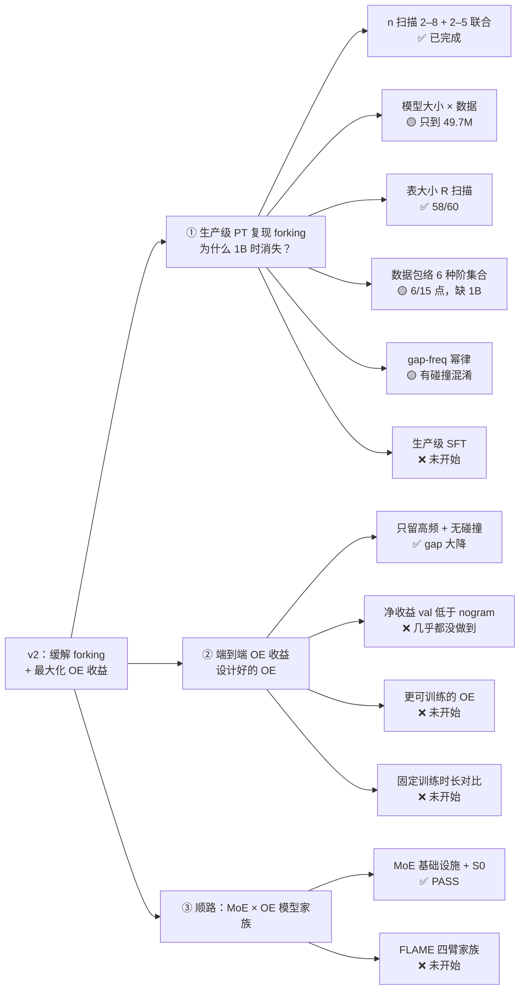

# v2 全景 · 2026-10-17 晚

> v2 目标：**缓解 forking，同时吃到尽可能大的 OE 收益**。机制线（为什么 fork）随论文发表已结题，
> 其结果在本文只作为缓解手段的依据。任务结构按飞书任务页
> （<https://mcna3q3ujim2.feishu.cn/wiki/EgPCwDniOiqsJDkBRA2cRdnxn6g>）。
> 聚合自三份 handoff：`v2-sweeps-e3-handoff-20261017.md`、`plan8-9-freeze0-countinit-handoff-20261017.md`、
> `../plans/plan-9-handoff-session-20261017.md`。数字已对 `output/harvest_{v21,e3}/` 抽查一致；
> run_id 全集见 `experiment-log.md` §73–§81。图：`../figs/v2_overview_20261017/tree.{html,png,svg}`。

## 1. 任务树

✅ 完成　🟡 部分完成　❌ 未开始/未解决

## 2. ① 生产级 PT 复现 forking

### 2.1 已有结果

除非注明 3-seed，均为 seed 42。gap = fixed-val − online train。

| 子任务 | 结论 | 关键数字 | 出处 |
|---|---|---|---|
| n 扫描（2000 步） | gap 从 n2 升到 n5 后持平；n≥5 的 val loss 超过均匀分布（ln 8192） | n2 2.61 / n3 5.54 / n5 6.56 / n8 6.29；2–5 联合 8.23（3-seed） | §76，27 臂 |
| 表大小 R（2000 步） | R≤1k 不 fork；R≥100k 进入高原；高阶集合在 300k 出峰后回落 | n2 @1M 2.53；n2–7 峰 9.58 @300k | §74，58 臂 |
| 数据包络（E=3，10M→49.7M） | 低阶随池单调降；n≥5 联合几乎不降 | n2 1.67→0.98；n2–3 4.11→2.75；n2–7 6.76→6.53 | §78，36 臂 + 3-seed |
| 模型大小（E=3，17M→159M） | 只开 trigram 时大模型更 fork；n2–5 联合时大模型反而略少 | tri 2.02→2.78；n25 4.97→4.44（49.7M 池，3-seed ±0.01–0.05） | §78，60 臂 + 52 seed 臂 |
| epoch 剂量 E∈{2,3,6} | 严格单调，无平台；E=2 已明显 fork；重复次数比池大小更关键 | n2–5 @49.7M：2.89/5.77/8.26 | §78，18 臂 |
| 协议修正 | 固定 2000 步在小池上等于 30 epoch，把 gap 高估 4–6× | n2 @10M：10.53（2000 步）vs 1.67（E=3） | §78 |

### 2.2 「1B 时 forking 消失」的三个嫌疑，目前判到哪

| 嫌疑 | 当前证据（≤49.7M） | 判断 |
|---|---|---|
| n 不够大 | n≥5 联合的 gap 几乎不随数据池下降，n2 则下降明显 | **支持**，最可能的主因 |
| 模型不够大 | 只有 trigram 时支持；n2–5 联合时大模型 gap 反而降 | 部分支持 |
| 表（词表）不够大 | R≥100k 已进高原，1M→2M 变化小 | 不支持 |

以上均是 ≤49.7M 池的外推，**1B 点本身还没跑**，结论仍是假设。

### 2.3 协议对齐（读历史数字用）

在 49.7M 池上：1000 步 ≈ 3 epoch，2000 步 ≈ 6 epoch。交叉核对：1000 步 bi+tri 对照
`frz0_ctrl_s42` 2.702 ≈ E=3 n2–3 2.754；2000 步 n2–5 hash 8.267 ≈ E=6 8.259。
**按 epoch 对齐后，不同协议的结果可以互读。**

### 2.4 未解决

- **>49.7M 的 9 个数据点（含 1B）**：handoff 记为「语料无读权限」，但 plan-9 线已在 ophis 用同一 8192 词表
  tokenize 了全部 163 分片，并做好了 main_1b 前缀（`data/manifest_full163/`）。缺的只是该池上的多阶 freq index。
  1B 只需跑一条 E=3（≈20k 步，≈1.6h/臂）：学习率 constant、同 seed、同数据顺序，所以 E=1/E=2 就是
  这条曲线的前缀，按飞书说的直接复用，不必另跑。等价性待用已有 E2/E6 臂的 train_log 核对。
- **无碰撞的 gap-freq 幂律**：§76 的 α 与「每行承载的上下文数」混在一起。188 臂（§78 166 + §73/§77 22）
  的 per-token dump 还在两台 360 上，没拉回本地分析。
- **R=3M 两个尾点**（n2–6、n2–7）：单卡 H200 放不下（138–165GB），需要表分片或多卡。
- **生产级 SFT**：v2 未开始。历史上有 continued-LM 对照（§57/58/68–72），不是 response-only SFT。

## 3. ② 端到端 OE 收益

### 3.1 continue-BPE + 无碰撞（飞书 2a-i，已完成）

dict = 只给 top-1M 高频上下文分配独占行；keephash = 同样只留 top-1M，但行仍用 hash；hash = 全部上下文 hash。
H200 同机，2000 步，seed 42：

| 阶 | hash gap | keephash gap | dict gap | 最好 OE 臂的 val | nogram val |
|---|---:|---:|---:|---:|---:|
| 2 | 2.57 | 1.82 | 2.14 | 4.41 | 3.32 |
| 3 | 5.65 | 1.59 | 2.13 | 4.25 | 3.32 |
| 5 | 6.59 | **0.92** | 1.17 | **3.76** | 3.32 |
| 2–5 | 8.27 | 3.87 | 4.43 | 5.57 | 3.32 |

- **只留高频（覆盖率）是降 gap 的主力**：hash→keephash 降 0.75–5.67。
- **在保留集合内再去碰撞，反而让 gap 略升**（+0.25～+0.64）。原因待 per-token 统计核实。
- **但 val 一个都没赢 nogram**：gap 降了，绝对 val 仍差 0.4–2.2。

### 3.2 净收益账本：val(OE) − val(nogram)，负数才算 OE 有用

| 手段 | 出处 | 约几个 epoch | Δval |
|---|---|---|---|
| 无约束 OE（input） | §43 | 6 | +3.58 |
| mask 低频 f≤8 | §43 | 6 | +1.33 |
| 只留 top-1M（keephash n5） | §77 | 6 | +0.43 |
| step-0 冻结 count-init 表 | §80 | 3 | ≈ +0.12（nogram 参照取自另一 run 的 3-epoch val 3.57，**非严格配对**） |
| 每 epoch hash reseed（input） | §43 | 6 | +0.81 |
| 每 epoch hash reseed（y / v 注入） | §43 | 6 | **−0.11 / −0.13**（唯一的净收益） |
| MoE S0，OE on vs off | §81 | 1 | +0.18（100M token，早期训练） |

**结论：OE 降 gap 已经有好几种办法，但「val 好过 nogram」只在 reseed + y/v 注入上出现过，幅度约 0.1。**
这是 v2 的核心未解决问题。另外 E=3 包络和 R 扫描**没有配 nogram 臂**，这两条线上的净收益现在算不了。

### 3.3 未解决

- **更可训练的 OE**（飞书 2a 后半句）：未开始，需要先定义候选。
- **保住表收益同时不 fork**：现有降 gap 手段都同时抬高 train loss，组合方案都还没跑，包括：
  - keephash + 每 epoch reseed；
  - mask 低频但保留 novel；
  - 第 1 个 epoch 后冻表或衰减 table LR；
  - count-init + 可学习。
- **固定训练时长对比**：没有按 wall-clock 对齐的比较；OE 的吞吐代价也没入账（MoE S0 里 OE 只慢约 1%）。
- **单 pass 下 OE 是否净赚**：现在没有可信的 1-epoch 配对数据（§66 的单遍对照因数据重复已作废）。

## 4. ③ 顺路：MoE × OE 模型家族（FLAME pivot）

依据 `../plans/plan-9-flame-pivot-addendum-20261017.txt`（与 Downloads 原件逐字节相同）。

| 项 | 状态 |
|---|---|
| 主线：每个尺度四臂 Dense / Dense+OE / FLAME-MoE / FLAME-MoE+OE | 定义完成 |
| 三点家族：Tiny 38M 激活/100M 总量，Small 115M/459M（主），Large 290M/1.3B | 定义完成 |
| 通用 MoE 代码、router 诊断、参数账本、CPU 测试 7/7 | ✅（旧 32R/top-4 降级为结构消融） |
| OE 审计 + 1B manifest（7.76B token 池，nested 前缀） | ✅ |
| S0（16R/top-4，OE on/off，100M×1 pass） | ✅ PASS |
| P1 `flame_profile`（64 routed/top-6 + 2×d_e 共享专家，第 1 层 dense，SwiGLU/RMSNorm/RoPE/无 bias/不共享 embedding） | ❌ |
| P2 dense twin（d_ff = 8×d_e：1408/2816/5632） | ❌ |
| P3 Small 四臂 S0（100M×1 pass） | ❌ |
| P4 Small 四臂 × 3 seed，1B × 3 pass（12 run） | 🔒 需用户放行 |

注意：pivot 用的是极简 setting 禁用的组件（RMSNorm/RoPE/SwiGLU），属于 P1 允许的「新架构变体」，
需在 experiment-log 写明偏离原因；与 v2 主线的数字不直接比较。

## 5. Todo

### 需要用户拍板

- [ ] push：`v2_main` 领先 `forking/v2_main` 24 个 commit。
- [ ] 360-2 配额清理（`ngram-gap-lab-plan7` 82G / `ngram-gap-exp` 75G / `workdir` 51G / `logs/failed_launch/`），不清则 360-2 停摆。
- [ ] 1B 在 ophis 直接跑，还是把约 2GB 数据搬到 360-1（>1GB 跨集群）。
- [ ] FLAME 家族的语料：保留 full-163（建议）还是重建 OpenWebText。

### 实验，按优先级

1. **给净收益补对照**：E=3 × 6 池 + E2/E6 × 两池端的 nogram 臂（约 10 臂，很便宜）。之后所有 OE 臂同时报 gap 和 Δval。
2. **OE 收益组合臂**（② 的主攻方向）：
   - keephash + 每 epoch reseed；
   - keephash 改用 y/v 注入；
   - count-init + 可学习；
   - 第 1 个 epoch 后冻表。

   先用 n5 和 n2–5 两个阶集合、E=3 @49.7M 筛选。
3. **1B 点**：在 manifest_full163 的 main_1b 上，n2 / n2–3 / n2–5 / tri 各跑一条 E=3，同时配 nogram；E1/E2 从曲线读。
4. **gap-freq 幂律**：拉回 188 臂 per-token dump，每个 n 出幂律；用 dict 臂给去碰撞后的指数，并核实「保留集内去碰撞反升」。
5. **更可训练的 OE**：先出候选清单并登记，再排卡。
6. **生产级 SFT**：等 1B 预训练点出来后，用它的 checkpoint 设计。
7. **FLAME 家族 P1→P3**：语料定后开工；P4 等放行。

### 文档卫生

- [ ] `experiment-log.md`：两个 §76 重编号；§73/§75/§77/§79/§80/§81 标题状态过期；§73/§77 的 22 臂矩阵误放在 §79 节内。
- [ ] `claims-ledger.md` 停在 09-13：补 dict/keephash（C6 可从 UNRUN 改为本地代理已测）与净收益账本。
- [ ] panel：第四个进程挂起的两处更正（§76「仅 360-1」、幂律指数表述），等你确认设置图后改。
- [ ] 工作区里不属于任何 handoff 的改动（`agents.md`/`cluster-infra.md` 的 A100 行、`dispatch_multilayer_posttraining.py`、4 个 LoRA 脚本），需要确认归属。

## 6. 接手必读的工程坑

- ophis：python 用 `/data/home/guoshaoyang/ngram-gap-lab/.venv/bin/python`（系统 torch 2.6 不可用）；`data/tokenized` 软链只读；写盘与 `TMPDIR`/triton/inductor 缓存走 /data1；GPU0/5/6 常空。
- 360-1：gpu0/3/7 ECC 坏，用 1/2/4/5/6；/data 99% 满；隔离树 `/data/shared/guoshaoyang/forking-v2-v21` 可复用。
- 360-2：用户配额满，停摆。A100：用户已禁用，且 n2–5 四表在 40GB 上放不下。
- `train.py` 多会话共写，改前完整重读；跑前 md5 核对；远端清理用 `mv` 不用 `rm -rf`。
